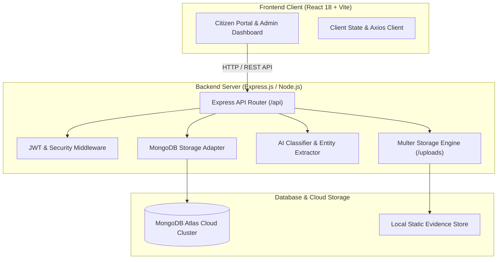

# 🛡️ Cyber Crime Reporting and AI Tracking System (CyberGuard AI)

An intelligent, full-stack web platform designed to streamline cybercrime complaint filing for citizens and automate incident triage, classification, and tracking for law enforcement authorities.


---

## 📌 Table of Contents

- [Overview](#-overview)
- [Key Features](#-key-features)
  - [Citizen Portal](#-citizen-portal)
  - [Admin & Law Enforcement Dashboard](#-admin--law-enforcement-dashboard)
- [System Architecture](#-system-architecture)
- [Technology Stack](#-technology-stack)
- [Project Directory Structure](#-project-directory-structure)
- [Getting Started](#-getting-started)
  - [Prerequisites](#prerequisites)
  - [Installation](#installation)
  - [Environment Configuration](#environment-configuration)
  - [Running the Application](#running-the-application)
- [API Endpoints](#-api-endpoints)
- [AI Classification Module](#-ai-classification-module)
- [Security & Data Protection](#-security--data-protection)
- [Academic Information](#-academic-information)

---

## 🌟 Overview

The **Cyber Crime Reporting and AI Tracking System** bridges the critical gap between citizens affected by cyber offences and law enforcement personnel tasked with investigating them. 

Traditional reporting portals often experience triage bottlenecks, lack transparency in case tracking, and leave victims uncertain of investigation progress. CyberGuard AI addresses these challenges through:
- **Instant Citizen Filing:** Step-by-step reporting with multipart evidence attachments and live webcam captures.
- **AI-Powered Triage:** Real-time threat classification, priority assessment, and suspect entity extraction (phones, UPI handles, phishing links).
- **End-to-End Tracking:** Transparent status timelines and instant notifications for every milestone.
- **Officer Workflows:** Powerful administrative dashboard with analytics, bulk triage, remark management, and soft-delete/restore capabilities.

---

## 🚀 Key Features

### 👤 Citizen Portal
- **Flexible Authentication:**
  - Password-based registration & login with Bcrypt encryption.
  - Quick Citizen Access via **Mobile / Email OTP + Security Captcha** verification.
  - Self-service **Forgot Password OTP Reset Flow**.
- **Interactive Complaint Lodging:**
  - Rich incident reporting interface.
  - Multi-file evidence uploader (screenshots, transaction receipts, documents).
  - Built-in **Live Camera Capture Modal** for immediate physical evidence recording.
- **AI Real-Time Analysis Preview:**
  - Dynamic categorization and priority prediction as the victim types.
  - Automatic extraction of suspect UPI IDs, phone numbers, and phishing URLs.
- **Transparent Case Tracking:**
  - Track by unique complaint token (`COM-2024-XXX`).
  - Track all complaints registered under a mobile number or email via OTP verification.
  - Interactive multi-stage timeline (`Submitted` ➔ `Under Review` ➔ `Investigating` ➔ `Resolved` / `Rejected`).
- **Notification Center:** Real-time bell notifications whenever an investigating officer updates case remarks or status.
- **Citizen Profile & Settings:** Manage contact information, notification preferences, and custom avatar photos.

---

### 🛡️ Admin & Law Enforcement Dashboard
- **Centralized Metrics Overview:** Live counts for total, pending, investigating, and resolved cases with resolution rate benchmarks.
- **Advanced Triage Filtering:** Search complaints by ID, citizen name, category, status, priority, or incident keywords.
- **Officer Case Review & Actioning:**
  - Inspect uploaded evidence files via inline image viewer / lightbox modal.
  - Update complaint stage, assign specialized officers, and append official investigation notes.
- **Interactive Analytics:**
  - Crime category breakdown charts.
  - Monthly complaint registration trend graphs.
- **Safe Case Management:**
  - Soft-deletion of duplicate/fraudulent complaints with an **Undo / Restore** trash bin.
  - Automated broadcast of status updates to citizens upon modification.

---

## 🏗️ System Architecture



---

## 💻 Technology Stack

### Frontend
- **Framework:** [React 18](https://react.dev/) with [Vite](https://vitejs.dev/)
- **Routing:** [React Router v6](https://reactrouter.com/)
- **Styling:** [Tailwind CSS 3.4](https://tailwindcss.com/)
- **Icons:** [Lucide React](https://lucide.dev/)
- **HTTP Client:** [Axios](https://axios-http.com/)

### Backend
- **Runtime:** [Node.js](https://nodejs.org/) (ES Modules)
- **Web Framework:** [Express.js](https://expressjs.com/)
- **Database ODM:** [Mongoose](https://mongoosejs.com/)
- **Security:** `bcryptjs` (password hashing), `jsonwebtoken` (JWT stateless auth), `cors`
- **File Uploads:** `multer` (multipart evidence handling)
- **Logging:** `morgan`

### Database
- **Cloud Database:** [MongoDB Atlas](https://www.mongodb.com/atlas) (Collections: `users`, `complaints`, `notifications`)

---

## 📂 Project Directory Structure

```text
cyber2/
├── backend/
│   ├── config/             # DB & environment configuration
│   │   ├── db.js           # MongoDB connection handler
│   │   └── env.js          # Environment parser
│   ├── middlewares/        # Custom middlewares
│   │   ├── authMiddleware.js
│   │   ├── errorHandler.js
│   │   └── uploadMiddleware.js
│   ├── models/             # Mongoose schemas & data models
│   │   ├── Complaint.js
│   │   ├── Notification.js
│   │   └── User.js
│   ├── routes/             # RESTful API route definitions
│   │   ├── adminRoutes.js
│   │   ├── apiRoutes.js
│   │   ├── authRoutes.js
│   │   └── complaintRoutes.js
│   ├── uploads/            # Statically served evidence uploads
│   ├── utils/              # Storage engine, token generators
│   │   ├── generateToken.js
│   │   └── store.js
│   ├── .env.example        # Template configuration
│   ├── package.json
│   └── server.js           # Backend entrypoint
│
├── frontend/
│   ├── src/
│   │   ├── assets/         # Static assets and graphics
│   │   ├── components/     # Modals, lightboxes, shared UI
│   │   │   ├── common/
│   │   │   └── modules/    # Citizen & Admin portal views
│   │   ├── context/        # Auth & Application state providers
│   │   ├── App.jsx
│   │   ├── index.css
│   │   └── main.jsx
│   ├── index.html
│   ├── package.json
│   ├── tailwind.config.js
│   └── vite.config.js
│
├── .gitignore              # Git ignore rules (protects credentials & data)
├── package.json            # Root workspace script runner (concurrently)
└── README.md               # Project documentation
```

---

## 🛠️ Getting Started

### Prerequisites
Make sure you have installed on your local system:
- **Node.js** (v18.0.0 or higher recommended)
- **npm** (v9.0.0 or higher)
- **Git**

---

### Installation

1. **Clone the repository:**
   ```bash
   git clone https://github.com/your-username/cyber-crime-reporting-ai-tracking.git
   cd cyber2
   ```

2. **Install root dependencies:**
   ```bash
   npm install
   ```

3. **Install Backend dependencies:**
   ```bash
   cd backend
   npm install
   cd ..
   ```

4. **Install Frontend dependencies:**
   ```bash
   cd frontend
   npm install
   cd ..
   ```

---

### Environment Configuration

In the `backend/` directory, create a `.env` file based on `.env.example`:

```bash
cd backend
cp .env.example .env
```

Populate the required configuration in `backend/.env`:

```env
PORT=5000
NODE_ENV=development
CLIENT_URL=http://localhost:5173

# MongoDB Atlas or Local Connection URI
MONGO_URI=mongodb+srv://<username>:<password>@<cluster>.mongodb.net/cybercrime_db?retryWrites=true&w=majority

# JWT Authentication Secrets
JWT_SECRET=your_super_secret_jwt_key_here
JWT_EXPIRES_IN=7d
```

> **Note:** Never commit the `.env` file to version control. The included `.gitignore` keeps it secured locally.

---

### Running the Application

You can start both backend and frontend servers simultaneously using the root runner:

```bash
# From the root directory (c:\cyber2):
npm run dev
```

Alternatively, run each service in separate terminal windows:

#### Terminal 1 — Backend:
```bash
cd backend
npm run dev
# Server runs on: http://localhost:5000
```

#### Terminal 2 — Frontend:
```bash
cd frontend
npm run dev
# Vite runs on: http://localhost:5173
```

Access the web application by opening [http://localhost:5173](http://localhost:5173) in your browser.

---

## 📡 API Endpoints

### 🔐 Authentication (`/api/auth`)
| Method | Endpoint | Description |
|---|---|---|
| `POST` | `/api/auth/register` | Register citizen / officer account |
| `POST` | `/api/auth/login` | Authenticate using email and password |
| `GET` | `/api/auth/captcha` | Generate security captcha code & token |
| `POST` | `/api/auth/send-otp` | Dispatch 6-digit OTP to mobile / email |
| `POST` | `/api/auth/verify-otp` | Authenticate via OTP & Captcha |
| `POST` | `/api/auth/forgot-password` | Request password reset verification code |
| `POST` | `/api/auth/reset-password` | Verify code and update user password |
| `PUT` | `/api/auth/profile` | Update user name, contact details |
| `POST` | `/api/auth/profile/photo` | Upload user profile picture |

### 📋 Complaints (`/api/complaints`)
| Method | Endpoint | Description |
|---|---|---|
| `POST` | `/api/complaints/predict` | Live AI analysis for incident text |
| `GET` | `/api/complaints` | Fetch complaints (supports filtering & search) |
| `GET` | `/api/complaints/:id` | Fetch specific complaint by ID |
| `POST` | `/api/complaints` | File complaint with multipart evidence |
| `PUT` | `/api/complaints/:id/status`| Update status, priority, and investigation notes |
| `DELETE`| `/api/complaints/:id` | Soft-delete a complaint |
| `POST` | `/api/complaints/:id/restore`| Restore a soft-deleted complaint |
| `GET` | `/api/complaints/deleted/all` | List soft-deleted complaints in trash |
| `POST` | `/api/complaints/track-by-contact` | Look up complaints by mobile/email with OTP |

### 📊 Administration & Metrics (`/api/admin`)
| Method | Endpoint | Description |
|---|---|---|
| `GET` | `/api/admin/stats` | Triage statistics, status counters & resolution rate |
| `GET` | `/api/admin/analytics` | Crime distribution charts & monthly breakdown |
| `GET` | `/api/admin/notifications` | Fetch system and citizen notifications |
| `PUT` | `/api/admin/notifications/read-all` | Mark all notifications as read |
| `DELETE`| `/api/admin/notifications/clear-all`| Clear notification log |

---

## 🤖 AI Classification Module

The built-in triage engine scans reported incident details using natural language pattern recognition and entity extraction to predict:

1. **Crime Category:**
   - `Phishing` — Fake login portals, credential harvesting, spoofed domains
   - `Online Fraud` — UPI fraud, fake QR codes, investment scams, lottery fraud
   - `Identity Theft` — Aadhaar, PAN card, or personal document misuse
   - `Social Media Scam` — Account impersonation, profile cloning
   - `CyberBullying` — Extortion, online harassment, abusive defamation
   - `Malware/Ransomware` — File encryption, trojans, malicious APK downloads
2. **Priority Rating:** Dynamically classified as `High`, `Medium`, or `Low` based on monetary severity and emergency keywords.
3. **Entity Extraction:** Automatically captures suspicious phone numbers, UPI VPA addresses (`user@upi`), and malicious URLs (`http/https`) to accelerate police forensics.

---

## 🔒 Security & Data Protection

- **Git Leak Prevention:** Comprehensive `.gitignore` safeguards `.env`, database storage files, and citizen evidence uploads from entering public repositories.
- **Password Security:** Salted and hashed passwords using `bcryptjs` with auto-rehash prevention.
- **Stateless Authorization:** Token-based authentication using industry-standard JSON Web Tokens (JWT).
- **Audit Trails:** Every status transition records exact officer notes, timestamp, and action history.
- **Soft-Delete Architecture:** Accidental or malicious deletions can be reviewed and restored without permanent data loss.

---

## 🎓 Academic Information

- **Project Title:** Cyber Crime Reporting and AI Tracking System
- **Project Domain:** Full-Stack Web Development, Cyber Security & AI Triage
- **Academic Degree:** Bachelor of Technology (B.Tech)
- **Batch:** Batch 8

---

## 📄 License

This project is developed for educational and academic submission purposes under the **ISC License**.

